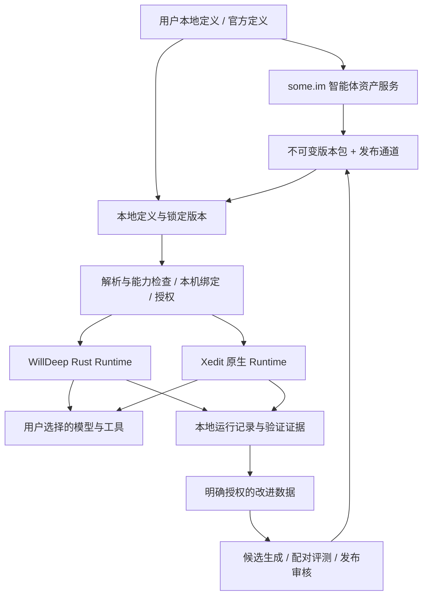
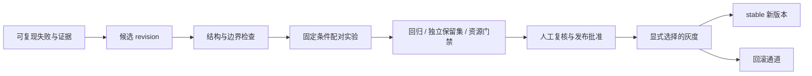

# 专业智能体定义、云端分发与 RSI 迭代：三端整体规划

日期：2026-10-13（Asia/Shanghai）。

状态：**架构建议，待实施；本次仅编写规划文档，不修改运行代码、数据库或线上状态。**

范围：WillDeep Rust（CLI / TUI / Web / Runtime）、WillDeep macOS（Xedit）、some.im（本次定位到 MuchToken Go 服务）。用户已确定总体方向：本地执行、用户可定义、登录 some.im 后提供分发和管理增强，并逐步接入 RSI。

现有能力及源码锚点见[三端现状证据](2026-10-13-agent-registry-rsi-evidence.md)。本文中的新类型、路径、接口、数据实体和阶段均为建议，不能作为已实现功能引用。

## 1. 推荐架构与产品定位

采用「共享智能体定义协议 + 客户端执行适配 + some.im 版本管理与分发」架构。

专业智能体是可复用资产：描述适合的任务、所需模型能力、工作指令、工具与技能、知识和评价标准。运行实例使用它的一份确定版本完成任务；RSI 根据结果证据提出并验证后续版本。

| 层次 | 职责 | 主要归属 |
|---|---|---|
| 定义协议 | 身份、版本、指令、能力要求、依赖、评测契约 | 三端共同遵守 |
| 执行适配 | 解析定义、选择本机模型、落实工具/权限、运行与验证 | Rust、Xedit 各自现有 Runtime |
| 资产服务 | 官方目录、私有定义同步、版本历史、发布、共享 | some.im / MuchToken |
| 改进服务 | 授权证据接收、失败归类、实验、晋升与回滚 | some.im 控制实验，客户端或受控 runner 执行 |

本地自定义、导入/导出及已安装版本的基础使用独立成立。登录增强提供官方维护版本、账号同步和后续团队能力；订阅层级、收费与配额尚未决定。

服务账号与推理 Provider 分开：登录 some.im 后仍可绑定用户自己的模型。需要 some.im 专属模型/工具的定义明确列出依赖。云端分发不要求把任务执行迁到云端。



## 2. 现状对设计的约束

1. Rust 已有五种公开职责、模型档位、工具/写集合约束、任务包、checkpoint 和反馈；配置主要覆盖模型与预算。需要补可加载的用户定义和定义版本身份，保留现有派工执行路径。
2. Xedit 已有 `AgentProfile`，统一子代理与调度台配置，包含 soul/runtime/capability、用户补充指令和多个技能预载。应迁移和扩展已有存储，不新增平行设置中心。
3. Xedit 自定义 profile 当前不会因设置 `requiresWriteAccess` 自动获得写能力。两端权限还有基于内置工种 ID 的判断，必须把「定义身份」与「受控执行职责」明确分开后再支持自定义实现者。
4. some.im 已有技能市场、包下载、MCP 发布、账号/租户/席位和请求观测基础。本次检索未找到独立的智能体定义、不可变版本和 RSI 实验注册服务。
5. Rust 的提示词 RSI 已有 Worker 分段变体、候选生成及对照门禁。现有 `model_eval.rb` 从主 Agent 的 `willdeep run --local` 进入，不能默认每题触发目标 Worker；需补直接针对定义版本的执行与覆盖证据。
6. Mac 反馈的普通结束仍记 `unverified`，不能当作独立质量通过。原生子代理 runner 有 verifier 处理，仍需证明每个实验的验证范围与实际接入路径。
7. 本轮观察到 Rust 子任务简报以文本为主；Mac runner 支持 openingImages。定义兼容不等于多模态、工具和运行效果兼容。

## 3. 统一概念：定义、版本、安装、实例与运行

| 概念 | 含义 | 生命周期 |
|---|---|---|
| AgentDefinition | 一个长期专业智能体，如「Rust 修复专家」 | 稳定 `definition_id`，可改展示元数据 |
| AgentRevision | 可执行定义的一份完整不可变快照 | `revision_id`、语义版本、内容 hash |
| AgentInstallation | 某账号/项目/设备选择哪个版本及本地绑定 | 可升级、固定、禁用、回滚 |
| AgentInstance | 某个父会话下拥有上下文的执行者 | 独立 `instance_id`，可按现有能力继续 |
| AgentRun | 实例的一次实际执行 | 独立 `run_id`、状态、用量与结论 |
| Experiment | baseline/candidate 的受控比较 | 固定任务、版本、条件和证据 |

职责 `role`、模型档位 `tier` 与专业定义是独立维度。专业定义引用现有受控职责，例如「Rust 修复专家」以 implementer 为执行基础；用户不能通过命名 `builtin:implementer` 取得权限。

同一专业定义可以被创建成多个实例；升级定义不修改已运行实例的版本和历史。继续、retry、recover 沿用现有语义，不能因下载新版本而悄悄换指令；需要换版本时创建新实例或明确的新版本执行。

与[一层多智能体调度规划](2026-10-12-single-level-multi-agent.md)对齐：该方案的队列、Agent/Run 身份和并发尚属于待实施工作。定义协议可先做，本项目不把“默认 8 并发、可继续”写成已经兑现的能力，也不另造第二个调度器。

## 4. 定义协议建议

### 4.1 三份数据，各自承担不同职责

**可分发定义包**：包含非敏感、可迁移的专业能力。由 revision 管理。

**本地安装绑定**：包含 Provider 实例引用、模型选择、凭据引用、工具映射、项目覆盖和授权选择。真实凭据留在当前客户端凭据存储；云端同步仅包含明确选择的可迁移偏好。

**运行快照**：记录这次实际生效的定义、依赖、模型、工具和约束，负责归因与复现。它不是公开下载包，敏感路径与规则默认留本机。

### 4.2 定义包字段

| 分组 | 建议字段与语义 |
|---|---|
| 身份 | `schema`、`definition_id`、`revision_id`、`version`、作者与来源 |
| 展示 | 多语言名称/简介、适用任务、示例、明确不覆盖的任务 |
| 行为 | 专业指令、报告要求、固定资源引用 |
| 执行 | `base_role`、支持的 executor、客户端协议版本要求 |
| 模型 | 输入模态、工具调用、上下文下限、允许协议；可选模型推荐 |
| 工具 | 通用能力 ID、必需/可选依赖、平台要求 |
| 技能 | 包 ID、不可变 revision/hash、预载顺序、必需性 |
| 知识 | 可分发参考文件及 hash；用户本地知识只保存逻辑槽位 |
| 记忆 | 隔离范围和读写策略；首期仅本地、默认关闭自动写入 |
| 预算 | 建议轮次、token/超时/输出大小；有效值受本地上限约束 |
| 评测 | 套件与 rubric 的版本引用、适用 Runtime 范围 |
| 完整性 | 资源清单 hash、包 hash、发布者签名元数据 |

建议以 `willdeep.agent-definition.v1` JSON 作为三端交换形式；允许客户端提供表单或 Markdown/TOML 编辑入口，最终编译为同一份定义。首期不实现任意继承树：只有固定基础职责与一份完整定义，官方定制通过 fork 明确保留来源。

示意（不是已实现的 schema）：

```json
{
  "schema": "willdeep.agent-definition.v1",
  "definition_id": "official/rust-fixer",
  "revision_id": "rev-example-1",
  "version": "1.0.0-rc1",
  "display": {
    "name": {"zh-Hans": "Rust 修复专家", "en": "Rust Fixer"},
    "description": {"zh-Hans": "处理具有可重复验证条件的 Rust 缺陷"}
  },
  "execution": {
    "base_role": "implementer",
    "executors": ["willdeep-native"],
    "input_modalities": ["text"],
    "requires_function_tools": true
  },
  "instructions": {"professional": "先复现缺陷，再修改限定文件，报告验证结果。"},
  "skills": [{"id": "official/rust-fix", "revision_id": "skill-rev-example-1", "required": true}],
  "tools": [{"capability": "workspace.read", "required": true}, {"capability": "workspace.edit", "required": true}],
  "memory": {"scope": "project-agent", "auto_write": false},
  "evaluation": {"suite_id": "rust-fix-v1", "rubric_id": "implementation-v1"}
}
```

正式版本包必须有完整资源 hash 和兼容要求；示意省略这些尚待确定的协议字段。schema 版本、智能体语义版本和三端 App 版本分别管理；共享 schema 不要求 Rust、Mac、服务端采用同一个软件版本号。各仓库内部版本一致性仍遵守现有规则。

版本号与内容身份分别使用：相同 definition 下语义版本唯一，内容变化创建新 revision；新增能力按功能版本管理，缺陷修订沿用用户要求的 rc 递增规则。列表展示元数据可维护，但历史 revision 的展示和执行内容保留原快照。

规范化与 hash 算法在 P0 固定，覆盖字符编码、对象键顺序、数组是否有序、缺省/null 语义、重复键拒绝和资源排序；两端不能直接对各自编码器的输出取 hash 后期待相等。

### 4.3 权限和行为合成

有效权限 = 宿主硬约束 ∩ 受控职责许可 ∩ 定义请求 ∩ 本次用户授权。

模型看到的专业指令、技能和记忆不能改写执行器的权限判定。项目/用户规则保留宿主现有优先级；指令冲突有明确解释，用户覆盖不解除强制权限约束。

定义中的预算是请求或建议，不能通过服务端升级提高用户已经设置的上限。发布者可以声明工具需求，不能下发 Always Allow、自动授权、真实 Key 或任意远程安装命令。

### 4.4 技能和能力的兼容

建立少量稳定的跨端能力 ID，如 `workspace.read`、`workspace.edit`、`process.verify`、`browser.inspect`、`image.inspect`。客户端适配为真实工具名，并返回能力支持情况和有效权限。

必需技能/工具缺失时给出 `incompatible` 或 `needs_setup`，不能启动一个仍显示“完整专业能力”的残缺实例。可选依赖缺失时记录降级。Mac 当前静默跳过技能的行为需要在受版本控制定义路径中改为可观测处理。

模型能力要结合实际协议、网关声明及验证状态判断；切换模型不能静默失去图片输入或工具调用。缺乏权威声明时展示未知，首期可要求配置检查或能力探测。

技能执行程序仍复用插件/工具的安装与审批机制。下载正文不等于批准运行脚本，包中资源不能越过目录边界。

## 5. 服务端分发与版本生命周期

### 5.1 建议服务布局

在 MuchToken 新增独立 `agentregistry` 领域模块，复用 `authapi` 登录/会话、客户租户解析、版本 header、请求 ID、迁移和配额基础；技能包引用已有 skillsmarket 的内容能力。

智能体版本单独存储，避免把 skillsmarket 的「GitHub 内置目录 + MCP 动态当前条目」直接改成私有智能体注册表。已有 skill hash 可用于锁定内容，但目前的按 slug 更新/下载不等于历史版本保留；依赖需要新增不可变快照或版本包存储。

第一阶段与现有主站服务同部署，保留模块边界。只有实验吞吐有实测需要时，再拆独立评测 worker。数据库无关的推理边缘节点不承载用户定义、发布审核或实验数据库。

### 5.2 下载和激活

1. 发现官方目录或登录后的私有资产，取得版本、兼容信息和权限要求。
2. 用户选择安装；读取固定 revision，检查包 hash、来源签名和资源清单。
3. 解压到 staging，验证路径、资源限额与依赖完整性。
4. 解析本机模型/工具/权限绑定，显示可用状态和新增要求。
5. 原子激活本地安装，记录锁文件，失败保留旧版本。
6. 派工读取安装快照；运行中不被目录刷新或通道更新影响。

默认检查更新并显示变更，用户选择升级或固定。自动跟随 stable 通道仅在显式设置后生效；新增工具、外传范围或权限需求仍需确认，不继承上个版本的无限授权。

官方版本包在首期就要有可信发布来源与完整性验证；数字签名的算法、信任根、轮换与撤销协议在 Phase 0 固定。签名证明来源，不证明任务质量。

私有包、索引与下载通过相同 ACL，使用私有缓存策略，不暴露到公开 CDN。下载地址不含长期 Key；若使用临时对象存储 URL，它必须短期、限定对象、从日志脱敏。

### 5.3 三种来源及更新规则

| 来源 | 写入/升级规则 |
|---|---|
| 内置定义 | 由客户端随版本提供；首期自动投影成 v1 定义，不改旧配置 |
| 官方云端定义 | 官方发布不可变 revision，stable/canary 指针可改变 |
| 用户定义 | 用户完整控制；本地创建，主动选择同步；私有为默认 |

用户修改官方定义时 fork 成新 `definition_id`，记录 `forked_from_revision`。上游更新只提供比较和合并建议，不能覆盖用户修改。定义正文变更创建新 revision，发布后的内容不可原地修改；下架/撤销改变状态与通道指针。

离线可使用已下载且符合本地使用策略的版本。未安装依赖或首次云同步离线时明确失败。切换账号后缓存按账号/租户隔离；退出登录停止私有同步并锁住私有资产入口，正在执行任务按已有任务授权完成或由用户停止。

团队撤权与离线缓存不能承诺瞬时同步：联网后重新检查，敏感团队资产后期可采用有期限的离线使用许可。已经下载的知识无法靠服务器“远程抹掉”，需在共享说明里讲清。

## 6. 用户自定义与跨端同步

### 6.1 自定义操作

提供创建、复制/fork、编辑、检查、试运行、导出/导入、固定版本、禁用与删除。创建时选择基础职责，填写适用说明、专业指令和技能，模型绑定从现有模型目录选择。

本地修改生成 draft；明确保存为新本地 revision。同步是单独选择，不因为登录或创建而默认上传正文。项目私有知识只留本机；同步逻辑槽位，另一台设备重新绑定。

建议项目定义位于 `.willdeep/agents/`，用户定义与安装缓存位于 `$WILLDEEP_HOME/agents/`，Mac 通过同一文件协议导入/导出；具体目录结构在 P0 固定，首期不让两端并发改写同一数据库或 UserDefaults。安装资源按内容 hash 隔离，mutable 安装选择由各端存储负责。

解析使用确定的 definition_id 与 revision：项目安装选择优先于用户级安装选择，内置仅作为未选择时的默认。相同展示名不是同一身份；云端目录刷新不覆盖同名项目文件。模型/预算等本地绑定逐字段合成并显示来源，专业指令编辑采用新 revision/fork。试运行 draft 也生成临时内容快照，不能把它记成正式已发布版本。

### 6.2 同步策略

定义、版本和非敏感偏好可以同步；Key、绝对路径、worktree、会话历史、运行 transcript、动态记忆首期不进入同步对象。

采用服务端对象版本与 `ETag / If-Match` 乐观并发。冲突返回 409/412 和可比较的版本信息，由用户合并或另存新定义；不用最后写入覆盖专业指令。写请求有 `Idempotency-Key`，删除有 tombstone，增量游标有有效期与全量恢复方式。

### 6.3 三个客户端入口

| 端 | 建议用户入口 | 复用与调整 |
|---|---|---|
| Rust CLI/TUI | 智能体列表、检查、安装、固定、fork、同步；派工显示定义/版本 | 扩展现有 Catalog 和配置；新增定义文件与本地安装存储 |
| Rust Web | 智能体管理、能力缺失提示、版本比较与使用选择 | 所有操作经 Runtime 控制 API；可见文案走现有 React i18n |
| Xedit | 在现有智能体设置加入官方/我的/项目来源、同步和版本信息 | 沿用 AgentProfile 与设置；迁移 UserDefaults 覆盖和 managed 记录 |
| some.im Web | 官方目录、我的定义、版本历史与后续实验页面 | React + 现有账号体系；首期不新建复杂市场系统 |

菜单/命令名在实施 UI 时统一，不在本规划中承诺现有 CLI 已支持 `agent install` 等命令。列表展示实际可用能力、模型绑定、版本和缺失依赖，模型选择与服务登录保持独立。

### 6.4 Xedit 外部执行器

首期云端专业定义只保证 `willdeep-native` 路径。现有 Codex/Claude 等外部执行档案继续保留；在没有专门适配器和验证证据前，专业提示词、技能、工具白名单和预算对它们标为不适用。

后续可以导出原生 profile，但要记录转换结果和丢失字段，不能因为名称相同就宣称与 WillDeep 原生版本等效。

## 7. 账号、权限与服务数据建议

### 7.1 服务身份

目录公开浏览与登录增强分开。私有资产服务以明确的 customer session 取得 user_id 和所选 tenant_id，再做对象 ACL；客户端登录标识头不能当用户身份，推理 API Key 也不能自动等价于私有资产所有者。

现有部分 API Key 换会话路径会在缺少 created_by 时寻找租户成员。新私有资产服务必须要求确定用户，不能靠“第一个租户成员”归属。Rust 需增加服务会话管理；Mac 复用现有共享会话/Keychain，并核对会话和租户切换。

新接口要明确校验 customer realm、实际 tenant membership 和对象归属，不能只套通用 authWrap。现有编程席位路径白名单也要同步补齐；团队发布权限与个人创建权限分别控制。

### 7.2 数据实体（建议，未生成迁移）

| 实体 | 关键内容 |
|---|---|
| agent_definitions | ID、owner_user/tenant、scope、名称、来源、fork 来源、状态 |
| agent_revisions | definition_id、version、parent revision、规范化 manifest、内容 hash、资源清单、签名、兼容要求 |
| agent_channels | definition_id + stable/canary 的 revision 指针 |
| agent_user_preferences | 所选版本、固定策略、非敏感同步偏好 |
| agent_audit_events | 创建、上传、发布、共享、回滚、撤销与操作者 |
| agent_experiments（后期） | baseline/candidate、条件、任务集、runner、评分与结论 |
| agent_evidence / outcomes（后期） | 去重运行摘要、验证证据引用、判定来源、授权范围 |

所有新增业务表遵循仓库迁移规范：主键、created_at/updated_at、关系/查询索引、必要唯一键、up/down 配对。定义内版本唯一、revision 不可变；内容修改通过插入新 revision。包正文与大资源可用对象存储，但 ACL 和 hash 由资产服务控制。

生产迁移要有 dry-run、回滚测试和部署审批。本轮不生成或执行 DDL。

### 7.3 API 草案（统一位于主站 /api/v1，下列均待实现）

| 阶段 | 接口族 | 用途 |
|---|---|---|
| P2 | `/public/agents/index`、`/public/agents/{id}/revisions/{revision}`、`.../download` | 官方已发布版本浏览与下载 |
| P3 | `/customer/agents`、`/{id}/revisions`、`/{id}/revisions/{revision}/download` | 私有定义、revision 与包，GET/POST/DELETE 按对象授权 |
| P3 | `/customer/agent-sync` | 游标同步、冲突及 tombstone；具体读写方法在协议阶段固定 |
| P4 | `/customer/agent-rsi/runs`、`/outcomes`、`/experiments` | 授权运行证据与私有实验 |
| P2/P4 | `/admin/agents/...`、`/admin/agent-rsi/...` | 官方发布、审核、通道晋升/回滚 |

正式接口采用服务端不含斜杠的 opaque object ID；`official/rust-fixer` 仅为定义名空间的示意，不能直接拼接成路由或文件路径。下载和列表的 ACL 必须一致。

复用现有 JSON envelope、错误码、分页与 request_id，所有新服务 API 返回 `X-App-Version`；资产另返回 schema/revision/hash。schema 不支持、能力不兼容、依赖缺失、授权不足、对象冲突各自可识别。

## 8. RSI：从提示词变体扩展到智能体版本

### 8.1 可以改进的对象与顺序

第一批只优化专业指令的一条行为规则，沿用现有 prompt variant 结构门。随后逐步评测技能选择/流程、经过验证的记忆提案、任务路由；每次修改单独声明假设。

模型和预算变化作为独立实验维度，不能与提示词改动混在一起宣称同条件提升。工具权限、审批规则、评分器和 holdout 不进入优化器可修改对象。

现有 draft/propose/check/gate 作为基础；新增定义 revision 的关联、适配器 fingerprint 和晋升服务。现有命令以代码内工种为目标，不等于已支持任意用户定义。

### 8.2 运行快照和来源

每次运行至少关联 definition_id、revision_id、instance_id、run_id、parent_session_id、客户端/Runtime 版本，以及：

- 专业指令、实际预载技能/参考资源的完整内容 hash 和截断/缺失状态；
- 本机模型/Provider/协议、实际 routed model、fallback、有效工具与授权策略版本；
- runtime_parameters、上下文/轮次/token/超时预算、workspace revision；
- 独立 verifier 或 rubric 版本、工具结果、人工判定与证据来源；
- request_id/trace 关联（供应商不提供时标为未知）。

manifest hash 与运行 snapshot hash 分开。有效快照还包含用户/项目指令与依赖，不能只靠现有稳定 prompt bundle hash 复现完整执行条件。敏感规则与路径留本地，获准上传的摘要只引用适当的 hash/枚举；hash 本身也不当作匿名化保证。

相同 revision 在两个 Runtime 上结果不同是正常实验条件；记录 runtime adapter fingerprint，分别发布适用范围，跨端未测时显示未验证。

主 Agent 派工时只读取可用定义的短索引（职责、适用范围、能力与版本），被选中的实例再加载专业正文和技能，避免把全部云端定义塞进每轮上下文。路由错误、依赖拒绝和重复派工可分别采集，后续评测路由策略时不与专业指令实验混合。

### 8.3 数据采集边界

| 数据层 | 内容 | 本规划默认 |
|---|---|---|
| 本地证据 | 运行、工具、verifier、人工反馈、必要复现材料 | 复用现有本机存储与正文设置 |
| 服务改进摘要 | 定义/版本标识、非敏感计数、状态、判定来源 | 用户单独开启，有删除/保留期与去重 |
| 私有实验材料 | 脱敏任务、patch、截图/日志、知识或正文 | 按材料和目标明确授权，不从遥测自动提取 |

已有 `/public/telemetry/events` 是白名单产品遥测，保持无自由正文入口；不把它扩展成 transcript/RSI 数据仓库。网关调试 trace 的保存范围与保留期也不等于用户同意贡献训练/评测数据。

官方迭代使用合成/公开授权任务及用户明确贡献材料；用户私有迭代保持 user/tenant 隔离。同步定义、同步记忆、贡献改进数据是三个独立设置。

### 8.4 评测与晋升



服务端的两条状态轴分开：revision 创建后内容不可变；评测状态为 draft → evaluated → approved/rejected，发布状态为 unpublished → canary → stable → retired/revoked。已评测不自动发布，已发布不自动让所有安装升级。

实验要求：

1. 固定 Runtime、模型/路由、预算、依赖、fixture、verifier/rubric、记忆快照与数据分组；每个 trial 独立环境，避免 baseline/candidate 相互污染。
2. 先证明目标定义真的执行：每题记录 effective revision/role；没有触发目标 Worker 的题不用于判断该 Worker 改进。
3. 数据按任务/项目/会话来源分组切分，保留集不进入候选生成或运行记忆。多轮试验后保留集也需更新，记录查看次数。
4. 小样本先标 exploratory；预先登记改进幅度、质量底线、重复运行方式与预算，不因候选过不了而临时降低门槛。
5. 成功/失败与 Provider/环境错误、预算耗尽、unknown 分别呈现；报告同时显示任务完成率、已执行任务质量和故障率，防止靠排除错误获得虚高成绩。
6. 不弱化现有安全/作弊/虚报门禁；成本和耗时比较只使用有测量的配对样本，缺失不能记零。
7. 专业指标与团队端到端指标同时看：审查发现增加但误报/重复工作增加，不能只靠发现数晋升。

官方 stable 的质量表述必须附套件、样本、模型、Runtime、预算和报告版本。Claude/Codex 的可配置和记忆机制作为能力包装参照，不作为已证实自动自我改进的证据。

P4 的实验执行有两条明确路径：客户端获准运行本机任务；服务端受控 runner 只运行已登记的 fixture、验证器和隔离环境。用户上传的 verifier 文本不作为主站 Shell 命令执行。服务端负责预算、队列和结果审核，评测 runner 的容器/进程隔离与取消要单独验收；源码仍可留在用户机器，只上传获准的摘要和证据。

## 9. 专属记忆的后续路线

首期不迁移所有聊天历史作为智能体记忆。后期建立 user + project + definition 的隔离命名空间，并记录经验来源、适用版本、置信度、有效期和验证状态。

记忆写入先产出 proposal，核对后进入 accepted；同类错误可以撤销或降权。迁移定义 revision 时声明是否继承该记忆，不能把旧错误经验无条件带入新版本。

RSI 评测使用固定、独立的记忆快照。官方知识与用户私有记忆分开；删除用户定义、账号退出和项目删除分别有明确记忆处理方式。Mac 已有 global/project 记忆存储，可扩展 namespace；Rust checkpoint 是执行上下文，不当作专属长期知识库。

## 10. 分阶段交付与退出条件

以下顺序以依赖和验收为依据，未给出日历承诺。每阶段交付后再进入下一阶段。

| 阶段 | 核心成果 | Rust | Xedit | some.im | 退出条件 |
|---|---|---|---|---|---|
| P0：协议与样本 | v1 schema、身份模型、能力映射、签名/缓存策略、金样 fixture | 确定 Catalog 适配与旧配置迁移 | 确定 AgentProfile 迁移与内置职责映射 | 明确用户会话/ACL、版本包数据契约 | 两端对金样解析/规范化/hash 一致；未知必需字段拒绝；协议评审完成 |
| P1：本地专业定义 | 创建、导入/导出、检查、试运行、固定版本；两个试点 | 以现有 implementer/reviewer 执行，自定义定义接入 Catalog | 扩展现有设置与存储，保留用户 soul/技能 | 暂不依赖服务器 | 两端各跑试点任务；权限不扩大；模型和必需依赖缺失可见；旧配置可回退 |
| P2：官方分发 | 官方目录、不可变包、可信来源、更新比较、离线缓存 | 下载/验证/激活/回滚，展示实际版本 | 同协议安装和更新；处理原生权限差异 | 官方注册表与管理员发布，复用技能资源；登录增强入口 | 同一 revision 两端安装成功，包损坏/不兼容不会替换旧版；运行中升级不改变实例 |
| P3：用户同步 | 私有定义、历史、fork、冲突与账号隔离 | 服务会话与本地绑定分离 | 共享会话接入、UserDefaults 非破坏迁移 | 私有 ACL、幂等/同步/tombstone、保留/删除 | A 创建 → B 使用 → A/B 冲突可恢复；跨账号读写/下载被拒；Key/路径不上传 |
| P4：首个受控 RSI 闭环 | 直接定义评测、授权摘要、单点指令候选、证据、批准/灰度/回滚 | 复用现有 proposer/gate，增加目标版本执行证明 | 同套件原生适配与外部验证；先实现可对照执行 | 实验编排与审核，不执行任意客户端上传命令 | 完整配对证据；保留集/资源门禁通过；人工批准；实际灰度与回滚可验证 |
| P5：团队和扩展 | tenant 共享、团队发布、记忆提案、视觉能力、路由评测 | 补图片传递和平台工具映射 | 扩展图片能力声明、专属记忆与团队入口 | 团队权限/预算、不同领域实验 | 团队撤权/冲突/预算测试与各领域验收通过 |

P0 金样需包含：内置投影、用户自定义、官方 fork、缺必需技能、缺可选技能、视觉模型不兼容、权限升级、外部 executor 不支持、未知 schema、损坏/撤销包、账号切换。

P1/P2 试点固定为「Rust 修复专家」与「独立代码审查员」。视觉检查员先保留协议字段，完整功能安排在 P5；若业务要求提前，须单独交付 Rust 图片输入闭环后再列为两端共同能力。

P4 优先让 Rust 执行首轮强反馈实验；Mac 在同阶段完成原生适配和独立验证，再发布 Mac 适用报告。不能用 Rust 的成绩替代 Mac 验收。

### 10.1 首个可用里程碑

P0—P2 构成「专业智能体基础版」：两端可本地定义，官方可发布，登录后能获取增强目录和管理入口，定义可绑定自己的模型，使用固定版本且可回滚。用户私有跨设备同步在 P3，自动候选与受控晋升在 P4。

若希望首个产品发布就兑现“在 Mac 创建、在 CLI 使用”，把 P3 作为该发布的必要范围；可以把基础版用于内部试用。这里区分开发里程碑与对外产品承诺，不提前决定发行日期/套餐。

### 10.2 未来实施拆分

- Rust：definition loader/validator、installation store、profile resolver、Runtime 查询/操作、服务会话、运行快照、定义评测入口；CLI/TUI/Web 共享 Runtime 来源。
- Xedit：AgentProfile v2 迁移适配、安装目录与 resolver、现有设置增量 UI、技能/图片兼容检查、实例版本/反馈归属；原生 executor 与外部 executor 独立验收。
- MuchToken：agentregistry 领域、authapi 路由与 ACL、包存储与签名、客户/管理员界面；P4 再加 experiment/evidence。React 文案统一 i18n，安装/脚本执行优先 yarn。
- 共同：schema/金样/能力 ID、错误语义、资源完整性、端到端验收；共享契约集中在 willdeep-rs 文档，后续建立两端契约漂移检查，避免三份手工规范。

## 11. 关键验收场景

| 场景 | 必须观察的结果 |
|---|---|
| 自定义修复者请求写集合外文件 | 运行时拒绝，报告真实拒绝；不因 source/name 获得写权限 |
| 官方包更新新增外部工具 | 旧版继续运行，新版显示新增要求，未授权不激活相应能力 |
| Mac 上必需技能被禁用 | 明确不可用或需设置，记录实际加载；不静默按完整定义运行 |
| 同一版本在两端运行 | 定义/依赖 hash 一致，Runtime/模型差异可见；质量分别验证 |
| 用户同步时两台设备同时编辑 | 保留两份修改，出现冲突，合并/另存后可继续 |
| 退出/切换服务账号 | 私有目录与缓存不串号，本地模型配置和任务授权不被替换 |
| 服务不可达或包损坏 | 已安装版本继续可用；更新失败不会破坏现有安装 |
| 正常完成但未跑 verifier | 标记 unverified，不当作质量通过 |
| 候选只提高轮次预算 | 标为不同条件实验，不宣称提示词改善 |
| 目标 Worker 没被调用 | 该 trial 不为目标定义提供改进证据 |
| 保留集答案进入记忆 | 实验无效，不能晋升 |
| 灰度后出现回归 | 能回滚通道和后续安装；历史 run 仍保留原 revision |

测试顺序：无 Provider 的协议/权限/迁移/同步测试 → mock Provider 的两端运行测试 → 原生/浏览器实际流程 → 小额、预登记的真实模型配对实验。Ruby 评测报告输出 JSON + Markdown；前端按现有 Vitest/浏览器工具验收。规划阶段不运行构建、付费评测或生产迁移。

## 12. 推进前需要拍板的少量产品决策

建议默认选项如下，本轮不因这些选择启动实现：

1. **首发范围**：内部基础版 P0—P2；对外强调跨设备管理时包含 P3；RSI 完整产品承诺待 P4 验证。
2. **官方目录访问**：基础目录可公开浏览，增强资产和管理需登录；收费、配额和权益另议。
3. **更新策略**：默认提示更新，用户固定或主动升级；自动通道跟随为显式选项。
4. **自定义来源**：本地创建、主动同步、私有默认；官方修改采用 fork。
5. **数据贡献**：默认不上传任务正文/记忆；实验材料逐类授权；产品遥测保持既有边界。
6. **跨端目标**：共享语义与版本、分别适配 Runtime；原生运行优先，外部 CLI 后续验证。

这份规划把服务端分发作为基础，把可复现评测作为迭代门槛。后续应按各阶段退出条件推进，任何功能和提升结论都以实际客户端执行与服务读回为依据。
