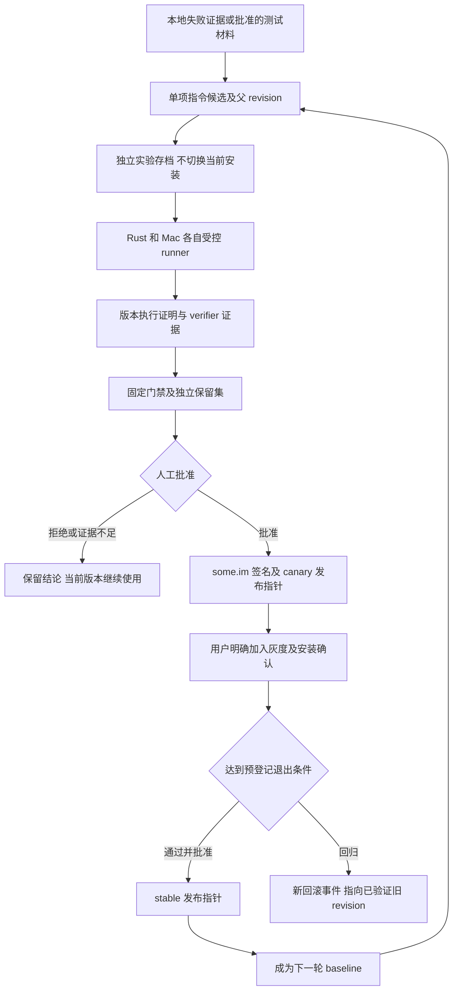

# 智能体 RSI 评测晋升与回滚分阶段方案

日期：2026-10-15。状态：待实施的规划；本次只新增本文，不改运行代码、版本、数据库或部署。

延续[2026-10-13 整体架构规划](2026-10-13-agent-registry-rsi-architecture.md)，以已经发布的 Rust、Mac 和 some.im 注册表实现为基础。原规划保留为历史设计，本文负责标清剩余工作及后续验收条件。

建议先交付一个受控闭环：**不可变执行证据 → 单项指令候选 → 固定条件配对评测 → 人工批准 → 显式灰度 → 稳定发布或回滚**。第一阶段优化对象是专业智能体的指令，不让优化器同时修改模型、权限、预算、评分器和测试集。第二轮必须继承上一轮已验证并保留的版本，才形成持续迭代；仅生成多个候选不能证明递归改进。

## 1 当前基线与原规划剩余项

### 1.1 已发布源码基线

| 系统 | 已发布版本 | 本次审计提交 | 读取位置 |
|---|---|---|---|
| Rust CLI Runtime Web | `0.101.0-rc6` | `dca043e3592e113393a00c44bbb9c3b37c56e45e` | `/private/tmp/willdeep-agent-registry` |
| Mac Xedit | `1.419.0-rc2` / build `917` | `a7eb98fbbfc354f787af08ccc09e225380d6a68c` | `/private/tmp/xedit-agent-registry` |
| some.im MuchToken | `0.248.0-rc3` | `856034428f84aea1eed5cd29df6788b76f8573a9` | `/private/tmp/muchtoken-agent-registry` |

以上是这次方案对照的源码快照；后续实施前重新确认分支、安装与生产版本。三个 primary 检出与这些发布检出不完全一致，不能拿 primary 中其他改动冒充已发布能力。

此前交付验收已经覆盖官方包安装、Mac → Rust 私有定义同步、Rust 修改 → Mac 接收，以及删除后的 tombstone 与重复同步不复活。证据见 `/private/tmp/willdeep-production-acceptance/cross-platform-sync.md` 和 `/private/tmp/mac-agent-registry-release/rc2-acceptance.md`。这些证明资产分发和无冲突往返成立，不等于 RSI 质量改进、真实灰度或全部冲突流程已经验收。

### 1.2 P0 到 P3 的实际完成边界

| 原阶段 | 已有实现 | 尚缺或需要单独验收 | 后续归属 |
|---|---|---|---|
| P0 共享协议 | 严格 v1、canonical SHA256、Ed25519、跨端 golden fixture；技能正文和 hash、fork 来源 | 原设计中的完整 executor、知识槽位、兼容版本、评测与记忆引用并未全进实际协议 | P4a 固定现有契约；复杂字段分期设计 |
| P1 本地定义 | 创建、编辑、导入导出、fork、本机模型绑定、受控职责与工具投影；内嵌技能锁定 | 项目级覆盖优先级、独立知识资源绑定、外部执行器和多模态不能视为已完成；端到端执行证据仍不完整 | P4a 补运行证据；知识与外部执行器延后 |
| P2 官方分发 | 不可变版本、签名校验、目录、历史版本、固定与本地回选、离线已安装使用；服务端 head 审计 | 独立候选存档、多通道、显式跟随、灰度、紧急禁用和密钥撤销机制尚缺 | P4c 至 P4e |
| P3 私有同步 | 明确客户身份、user 与 tenant 隔离、ETag、幂等、tombstone、冲突保留；基础跨端往返已验收 | 真实双端冲突解决与账号切换需补原生验收；当前采用全量快照，没有原规划的增量游标与失效恢复；回滚同步语义需要明确 | P4a 验收冲突和隔离；P4d 明确回滚；游标按容量另排 |
| P4 受控 RSI | Rust 旧 Prompt RSI 有候选起草、结构检查、配对门禁与报告；两端有部分反馈和验证材料 | 定义级实验、统一证据、独立候选、授权上传、批准与发布关联、灰度及回滚闭环未交付 | 本文主要范围 |
| P5 扩展能力 | 尚不能据注册表上线判定完成 | 团队协作、长期记忆、视觉评测、路由优化、迭代策略优化 | 保持后续阶段 |

技能并非完全未实现：当前 v1 已支持带正文、hash 和 required 的内嵌技能。缺的是原设计更完整的外部资源依赖、兼容性及运行证据，不能重复从零设计技能系统。Rust 当前 Worker 投影会拒绝图片输入；定义能声明 image 不代表该执行适配器能完成视觉任务。

### 1.3 旧 Prompt RSI 与定义 RSI 的连接点

Rust 的 `prompt_rsi_eval.rb` 通过 `model_eval.rb` 比较 `prompt-variant.v1`，检查任务集、实际提示词 bundle、Runtime 参数、validation、regression、holdout 及成本。它的 `candidate_passes` 表示可交人工审查，**不表示已发布**。`--profile` 是 Provider 配置，不能当成目标智能体选择器。

当前门禁包含 validation 提升至少 3 个百分点、regression 全通过、token 增长不超过 15%、耗时增长不超过 20%，并要求 holdout 不降及完整性检查。这些是旧套件现有规则，不应不加评估地变成所有专业智能体的通用晋升标准。它也不能替代重复试验和不确定性分析。

Rust 派工记录已冻结定义，Mac 的 `AgentRevisionSnapshot` 已进入运行与 transcript；两端反馈账本尚未完整绑定 definition revision、experiment 与试验臂。Mac 前台、后台及 Goal 的 verifier 材料也没有统一：后台 transcript 目前没有完整带入 outcome 的验证结果。some.im 的现有结构化模型评测是直接模型协议探测，现有报告可更新；二者都不能直接充当不可变的智能体晋升凭证。

## 2 三端职责与最小闭环

| 系统 | 主要职责 | 不能由它单独决定的事项 |
|---|---|---|
| Rust | 首个定义级评测 runner；CLI 控制和 JSON 加 Markdown 报告；Runtime 暴露实际执行证据；Web 展示结果与版本选择 | 用普通完成状态代替质量，或由本机自报结果自动发布官方版 |
| Mac | 原生 Worker 的同契约 runner；补前后台证据；原生差异预览、实验确认、灰度、固定与回滚 | 用 Rust 成绩直接取得 Mac 已验证标记；保存候选即改当前安装 |
| some.im | 实验资产、授权与 ACL、证据接收、审核、签名、通道指针及审计 | 在主站进程执行用户上传的 Shell；把登录或遥测许可当成实验数据贡献许可 |

先采用本地控制器及少量受控 runner，不新增通用工作流引擎。官方证据需要可复核的受控执行；用户设备上传的结果标为 client-reported，可用于私有实验或线索，不能仅凭声明自动取得官方晋升资格。

用户入口放在现有智能体管理页：显示当前版本与来源、是否固定、适用范围；实验区显示“待评测、待审核、试用中、已发布、已回退”及质量和费用摘要。创建改进候选不改变当前使用版本，选用前可看差异和数据上传范围。Rust Web 与 Mac 保持这些操作语义一致，some.im 提供官方审核与发布管理；实验 ID 和完整 hash 放在详情与报告中，界面文案沿用各端国际化机制。

## 3 数据模型与状态分离

### 3.1 复用现有定义与安装

继续以 `definition_id + revision SHA256` 标识不可变内容，语义版本用于展示，不能代替 hash。保留 Definition、Revision、Installation、Run 的分层；本机模型凭据、绝对路径和权限批准不进入可同步包。

实际 `AgentDefinitionV1` 严格拒绝未知字段。因此实验与评测先采用独立旁路契约，通过 revision 关联；需要更丰富的知识、兼容性或执行器协议时，再设计明确的新 schema 和旧端降级规则，不能直接给旧 v1 塞字段。

### 3.2 新增最小实验领域

以下名称为建议，不代表已有 API 或数据库表；实际迁移按实施时数据库最新序号编排，不修改已提交的 226。

| 实体 | 需要冻结的内容 |
|---|---|
| EvidenceGrant | owner、用途、允许材料、上传范围、有效期、保留及撤回规则；区分私有实验与贡献官方 |
| ExperimentSpec | 父与候选 revision、假设、单项改动、平台适配范围、suite 与 split、Runtime、模型、预算、门禁版本、最大花费与停止规则 |
| CandidateRecord | 独立候选包、父 revision、生成者与优化器版本、来源证据引用；登记不会移动任何安装或分发指针 |
| Trial 与 ExecutionEvidence | 每题每臂及重复号、根与 Worker 关联、恢复段、实际版本、完整执行条件、结果类别及 verifier 证据摘要 |
| EvaluationDecision | 不可变输入集合 hash、门禁版本、结果及不确定性、证据可信级别、审核人与理由；重算追加新结论 |
| ReleaseBinding 与 ReleaseEvent | 已批准 decision、平台和模型适用范围、通道、旧新 revision、expected ETag、审核人、灰度条件；回滚也是新事件 |
| RevisionRestriction | 下架、停止新安装、安全禁用等不同限制，签发者、原因、有效期和客户端处理规则 |

原始证据可在本机或私有对象存储保留，关系库保存索引与摘要。已公开的旧报告展示接口可呈现结果摘要，但晋升读取不可变证据与 decision，不能读取一份可覆盖的展示 JSON 作依据。

### 3.3 三条状态轴

1. **评测状态**：draft → registered → running → evaluated；结果为 passed、rejected、inconclusive、invalid，再产生独立人工 approved 或 denied。中断与环境错误不强行挤进质量成败。
2. **发布状态**：unpublished → canary → stable → retired；安全限制独立记录。评测通过不自动改变发布状态。
3. **设备安装状态**：downloaded、compatible、selected、pinned、disabled，以及实际生效 revision。批准发布不等于设备安装成功。

现有官方 POST 会保存 revision 并激活 head，私有 PUT 会移动当前私有指针；Mac 当前保存入口也会选择新版本。这三处都不能直接作为候选登记入口。必须先提供只存实验候选、不激活的路径。

## 4 评测证据与归因

### 4.1 每次执行必须能够回答的问题

| 维度 | 最小证据 |
|---|---|
| 目标是否真的运行 | definition ID、revision、base role、effective prompt hash；目标 Worker 的 start 和终态；未调用时标记 coverage 缺失 |
| 根任务与子任务关系 | experiment、trial、task、重复号、arm、root run、worker run、attempt、恢复段的关联；同一任务恢复不算新独立样本 |
| Runtime 与执行适配 | 产品版本、commit、二进制或 App 摘要、OS 与架构、adapter 版本、前台或后台模式 |
| 模型条件 | 请求的绑定、实际 provider/model、可得的模型修订、路由与升级链、生成参数；秘密只留本机引用 |
| 权限与依赖 | 生效工具集合、宿主权限策略、任务批准范围摘要、锁定技能与顺序、项目规则摘要；不上传原始路径 |
| 资源条件 | 根与 Worker 的有效轮次、token、timeout、并发、重试预算；所有辅助调用、评审器及优化器的费用分别记录 |
| 数据与工作区 | suite、task、fixture、仓库快照、split、记忆快照和初始状态摘要；两臂独立的工作区、缓存与 home |
| 验证结果 | verifier ID 和版本、输入摘要、退出码、输出证据引用、passed/failed/unverified；人工裁决与模型建议分开 |

客户端构造声明与可信 runner 证明分级展示；包签名证明来源与完整性，不证明质量。提交证据包含自洽字段仍不代表其执行可信。

### 4.2 不用界面状态代替事实

两端需要持久化不可变 run 事件与证据引用。根 Agent 当前列表的 Completed、普通对话完成、模型自评分、下一句建议采用率都不能直接算质量通过。此前恢复验收中根状态投影可能随历史任务重建变化；它只可用于界面，不可作 RSI 标签。

Mac 崩溃可能只留下 run_started，没有 finished；恢复后新运行段要关联原 trial，标记 interrupted 或 resumed。Goal 遗留 verifying 重新验证的规则继续保持。Rust checkpoint 重跑也必须保留 attempt 血缘，不能重复计分或只挑最好的一次。

### 4.3 直接评测和端到端评测各自回答不同问题

- **直接定义评测**：明确调用固定 revision，隔离主 Agent 是否选择它的影响，测专业能力。缺目标执行证明的 trial 无效，不记成该定义成功。
- **团队端到端回归**：保留正常派工链，测主 Agent 能否正确选用、委派与合流，是否引入更多总开销。没有触发目标时记录覆盖率，不能借其他 Worker 的成功宣称候选提升。
- **入口验收**：Rust CLI 与 daemon/Web 是不同装配路径；Mac 前台与后台也必须分别验证证据没有丢失。CLI 本地成绩不能自动覆盖全部用户入口。

同一包在两端 hash 一致，只证明定义相同。Rust 与 Mac 的预算、模型与宿主行为分别计分；发布适用范围按已验证的平台、adapter、模型组合标记。先取得 Rust 资格的版本不应自动替换尚未验证的 Mac stable。

## 5 测试集门禁与费用控制

### 5.1 测试材料与防止泄漏

建立三个互相隔离的集合：开发与失败分析集、固定 validation 加 regression 集、独立 holdout。按项目和来源会话分组，避免同项目的近似问题落入不同集合。各 split 的内容 hash、fixture 与 verifier 预先冻结。

优化器只能看到允许的失败归类与开发材料，看不到 holdout 题目、答案和逐题诊断。holdout 由独立 runner 或持有者执行，设置查看次数和候选尝试预算；反复试到通过会消耗保留集，达到上限需要轮换，不能把它继续当独立证据。隔离运行不能读取另一臂产物、历史候选答案或其他试验的记忆。

### 5.2 预登记实验而后执行

每个 ExperimentSpec 固定：主要质量指标、最小有意义增益或非劣界值、置信水平与统计方法、重复数、随机或交错执行顺序、样本量依据、资源上限、最大重试、最大候选数、停止条件和总预算。

P4b 的首次真实模型请求之前就必须落实预算准入、并发和重试上限、候选数量上限、holdout 访问计数与停止措施。总预算覆盖 baseline、candidate、重复与重试、holdout、优化器和评审调用；预留在途请求的未知消费，达到上限不再发起新请求。P4e 只完善这些控制的持续运营，不推迟基础控制。

模型输出存在随机性，baseline 与 candidate 在同一时段、同模型配置下重新配对运行，采用随机化 AB/BA 顺序并保留全部重复。不要拿长期旧 baseline 与今天的候选比较。可得时固定 seed，但不能声称 seed 足以消除随机性。模型供应商未提供固定模型修订时记录时间与路由，结论限于该条件，不能保证逐 token 重现。

基础设施失败按预登记规则重试，超限使实验 invalid 或 inconclusive，不能丢掉失败行只比较幸存样本。质量超时、预算耗尽按预先定义的失败规则计分并单列。样本不足时输出 exploratory，扩大实验或拒绝晋升，不能事后降低门槛。

### 5.3 首批指标

| 试点 | 主要质量指标 | 必过回归 | 资源指标 |
|---|---|---|---|
| 独立代码审查员 | 对带已知缺陷和无缺陷对照的发现准确率、召回与证据可复核率；预登记主要指标，防止靠少报问题刷准确率 | 无越权写入、无编造证据、无泄露；严重缺陷不漏检；输出合同可解析 | 每题总 token、费用、墙钟时间、人工复核量 |
| Rust 修复专家 | 固定测试及隐藏测试通过率，受保护文件不被修改 | 无虚报完成、无测试篡改、无权限放宽；端到端合流与已有功能不回归 | 根和 Worker 全部调用、重试、辅助调用、耗时及成本 |

安全、越权、受保护文件和关键回归采用零新增失败的硬门；平均质量分不能抵消这些失败。一般质量用预登记的配对差异和不确定性判定，不能只看高了几个百分点。

结果至少区分 passed、failed、unverified、infra_error、interrupted、budget_exhausted、invalid。用量未知不记零，缺失率单列；关键血缘和验证材料缺失阻止晋升。模型评审可提供线索，不能单独确认可执行的修复正确，人工抽检与分歧处理独立留痕。

首轮先测只读审查员，再测修复专家。每个试点先做小样本可行性检查，确定方差与样本量后登记正式实验；小样本不承诺提升。首批真实评测的模型、题量和人民币预算在执行前形成具体实验清单，不在本次规划中启动。

## 6 版本晋升与灰度

### 6.1 从候选到可发布版本

1. 从当前已验证 revision 创建子候选；首批仅改变一条专业工作规则，保留 parent 与 diff。权限、安全约束、模型、工具、预算、技能、评分器及测试集保持固定。
2. 结构与权限检查通过后登记实验。候选在隔离 home 和工作区中运行，不改用户当前安装、私有 current 或官方 head。
3. 完成直接定义评测、回归、holdout 与端到端检查，生成绑定证据摘要及门禁版本的不可变 decision。
4. 用户本人批准私有候选，官方维护者批准官方候选。优化器和 runner 无发布权限；人审不把失败或缺失证据改写成 passed，需要另开实验。
5. 发布时校验 parent、candidate、decision 摘要、授权有效性、兼容范围及 expected ETag，并与通道 CAS、发布绑定和审计进行同事务或等价原子条件提交；不能先检查再无条件调用发布接口。当前 baseline 已变化则重审或重测。canary 晋升 stable 也绑定原批准证据和当时的 ETag。
6. 官方包由发布服务签名后绑定 canary。定义包内容保持不可变，通道移动追加审计，不重新改写同版本正文。

私有改进不自动贡献给官方；官方新版本不覆盖用户 fork。本机 pin 默认继续有效，用户可主动升级或明确加入通道跟随。

### 6.2 灰度对象是智能体包

stable 与 canary 指向确定 revision，并携带平台、最低 Runtime、adapter 与已验证模型条件。灰度是智能体定义升级；需要新 Runtime 能力时先走普通产品发版，再开展该能力范围内实验。

建议先按内部测试设备 → 明确选择加入的用户推进，首批不默认随机升级现有用户。使用稳定 cohort 标识和确定版本，避免同一实验对象来回切换。客户端上报下载、校验、兼容、激活及实际启动确认，未启动的安装不能算质量样本。

每次灰度预登记：目标设备或用户范围、最短观察窗口、最少有效执行、关键回归、证据覆盖率、错误与资源阈值。单纯经过 24 小时或没有投诉不能证明通过；业务差异、缺标签与贡献授权不足时，灰度只证明兼容和稳定性，质量结论仍来自受控评测。

初版 stable 晋升继续人工批准。检测到硬门失败立即暂停新分配并告警；达到确定的回滚触发条件执行已批准的回滚策略。分配率、暂停和回滚分别记录，不能把关掉灰度误报成全部设备已经降级。

## 7 回滚限制与运行中任务

| 层次 | 处理方式 | 必须验证 |
|---|---|---|
| 官方通道 | 用 CAS 和新审计事件把指针指回最近兼容且已验证的 revision；epoch 或事件序号只增不减 | 并发晋升不会覆盖回滚；两端能收到新事件并报告实际生效版本 |
| 设备安装 | 下载并验证完整包后原子切换选择；保留上个兼容版本、pin、本机模型绑定和授权边界 | 崩溃或断网不破坏现有安装；回退版本不能越过安全限制 |
| 私有云端 current | 将旧内容发布为新的期望版本，以当前 ETag 提交恢复并生成新的同步事件；本地回退与云端恢复分开 | 旧 ETag 不复用，tombstone 不倒放；固定、离线与冲突设备分别处理，以激活回执确认收敛，不覆盖未同步改动 |
| 已运行或恢复任务 | 继续使用开始时冻结的 revision，历史保留原版本；质量回滚影响后续新任务 | 进程重启后不偷偷替换版本；旧包不可用时显式停止，不能换版续跑后仍记原试验 |
| 实验服务 | 独立暂停候选生成、付费 runner、上传与发布；本地普通任务照常按既有安装运行 | 停止可阻断后续请求；已在途调用的费用与结果按未知暴露处理 |

现有 Rust `select` 会设置 pinned 和 dirty；Mac 回选也会固定。它们能作为本地版本选择基础，但不天然等于“只本地回退且永不写云端”，需在实施时把操作意图和同步策略明确拆开，并补跨端测试。

定义回滚不自动回退模型、Runtime、数据库，也不撤销智能体已经产生的文件改动或外部副作用。需要项目代码回退时走独立审查与用户授权，不把它藏进资产回滚。

### 7.1 下架与安全禁用分别处理

当前 some.im 官方 `active=false` 是目录隐藏，固定旧 revision 仍可获取；私有删除保留历史 revision。因此当前行为不能称“强撤销”。

后续明确四种操作：目录下架、停止新安装、禁止该版本开始新任务、删除符合隐私规则的原始材料。安全禁用可以高于 pin，普通质量回滚尊重 pin；已经运行的任务按预设安全策略在安全边界停止。私有删除不能混用为官方安全禁用。

普通版本允许离线继续使用。依赖在线撤销保证的受管版本需明确状态缓存有效期和离线过期行为；离线设备无法获得实时禁用消息，不能承诺即时收回已下载定义。首版应展示最近校验时间，先实现联网阻止新启动和可审计的限制状态，再承诺更严格的托管保证。

## 8 授权存储和执行边界

定义同步、私有实验上传、贡献官方材料三种授权分别展示、分别撤回；some.im 登录授权及推理网关 Trace 均不能替代。默认只在本机记录必要摘要，上传正文、代码、图片、命令输出与长期记忆都需要对应范围授权和脱敏预览。

证据隔离至少遵循 user、tenant、experiment。撤回后停止后续收集和使用，原始材料按约定删除或脱敏；已经形成的必要发布审计可保留无正文摘要。材料被删除导致不可复核时，将 decision 标为证据不再可用，阻止新的晋升；不能声称既有公开成果被物理收回。

受控 runner 使用只读或隔离工作区、受限凭据、固定 fixture、明确网络与资源策略。平台主站不执行用户定义中的任意命令。优先复用现有 Runtime 权限强制，不能把“候选包校验通过”理解成获得工作区访问授权。

## 9 分阶段实施与退出条件

阶段按依赖验收，不按日期自动推进。P4a 后可以三仓库并行，但共享契约与验收 fixture 先固定。

| 阶段 | Rust | Mac | some.im | 退出条件 |
|---|---|---|---|---|
| P4a 基础补齐与证据契约 | 直接 revision 选择设计；持久化 root 与 Worker 关联、恢复段及有效配置；排除列表状态标签 | 统一前后台 verifier 与运行参数证据；恢复关联；接入已有定义快照 | 独立候选和授权模型、证据 schema、ACL 与幂等契约；保持现有 v1 | 三端 golden 一致；缺字段和篡改拒绝；恢复不重复计分；补真实冲突解决与账号切换验收；不启动付费实验 |
| P4b 本地定义级配对评测 | 复用 Ruby 门禁与 checkpoint，新增明确目标 revision、隔离两臂、测试集与报告 | 原生 runner 实现同契约，覆盖前台和后台；不必复制 PromptVariant 系统 | 提供私有候选存档与证据索引，不激活指针；落实预算与保留集访问准入 | mock Provider 验证候选不影响当前安装；目标未运行不能得分；付费前预算、重试与停止控制通过；随后完成批准预算内的首个审查员真实实验；两端各出结论，无提升也应如实完成 |
| P4c 人工晋升与私有闭环 | 显示差异、decision、适用范围；用户确认选用与本地回退 | 原生实验入口、证据摘要、确认与固定；保存和候选分离 | 不可变 decision、审核角色、发布绑定及 CAS；私有当前版本恢复事件 | A 生成候选、B 评测或查看、本人批准后两端接收；拒绝不生效；过期批准与篡改不能发布；完整私有恢复及冲突回归 |
| P4d 官方灰度与回滚 | canary opt-in、安装确认、限制状态、运行快照冻结；Web 有可见状态与退出 | 同契约通道与回滚，不能靠 Rust 资格自动升级 Mac | 分平台发布范围、stable 与 canary、cohort、暂停、回滚审计、联网限制 | 实际官方灰度演练：升级、运行、模拟回归、暂停、回退；两端读回 hash；处理中任务保持冻结；离线与 pin 行为符合策略 |
| P4e 连续迭代与运营 | 批量候选去重、预算运营、历史对比、导出完整 JSON 与 Markdown | 展示版本血缘、验证范围与用户控制；后台长期可靠性 | 持续调度批准实验、保留集轮换、成本分析、审批队列、可观测性和密钥生命周期 | 至少完整演练两轮父子继承；拒绝或回滚可恢复；每轮可复核；达到预登记证据才宣称改进；仍不默认自动 stable |
| P5 能力扩展 | 路由与复杂执行器逐项适配 | 视觉输入和原生能力专门验证 | 团队 ACL、记忆提案、受控共享 | 每种新能力独立测试集和权限契约；之后再研究优化策略本身的迭代 |

P4a 必须补的是影响归因、实验隔离和安全发布的缺口。项目级覆盖、外部知识包、全量改增量同步并非最小 RSI 必经步骤：当前注册表规模可继续全量快照，扩展容量时再设计游标、快照边界与失效恢复。它们仍保留在旧规划未完成清单，不静默销账。

## 10 验收场景与交付报告

| 场景 | 预期行为 |
|---|---|
| 运行时更新同一智能体 | 当前 run 保留旧 revision；新任务使用确认的新版本 |
| 目标 Worker 未被调用 | 直接试验无有效目标证据；端到端报告 coverage，不记目标成功 |
| 后台丢失 verifier 或证据只写一半 | unverified 或 invalid，不能晋升 |
| 崩溃恢复及重复上传 | 同一 trial 的恢复段或 attempt；幂等收敛，不扩大样本数 |
| 模型路由或预算变了 | 独立条件或实验无效，不能归因于指令改进 |
| 只在 Rust 通过 | 仅发布 Rust 适用资格，Mac 保持已验证版本 |
| 保存候选或评测被拒绝 | 本机 selected、私有 current 和官方 head 均不变 |
| 保留集材料进入候选上下文 | 实验 invalid，按规则轮换数据；不允许补个说明就晋升 |
| 候选被篡改或 baseline 已更换 | CAS 或摘要校验失败，重新审批或评测 |
| 同时升级与回滚 | 单一有效通道事件；冲突可见；后续同步不倒放历史 |
| 一端固定旧版本或有未同步修改 | 普通更新尊重固定；冲突保留；安全禁用按独立规则处理 |
| 数据授权被撤回或账号换租户 | 停止后续上传及访问；私有实验不串号；模型凭据不被同步替换 |
| 502、缺成本、模型审评说完成 | 分别记录基础设施失败、用量未知与评审意见；没有 verifier 就不记通过 |

每阶段输出：协议及 golden fixture、测试 JSON 与 Markdown 报告、源码和构建身份、真实入口验收结果、未覆盖项、预算实际支出。质量报告、Git 交付、公开发布和本机生效分别记录。实施期修改代码遵守各仓库版本与 changelog 规则；生产结构变更仍需具体 SQL、备份和人工审批。

## 11 建议采用的首轮范围

先完成 P4a 和 P4b：复用 v1 注册表，以只读代码审查员跑通定义级评测，再验证 Rust 修复专家。第一轮只改专业 instructions 中一条规则；无长期记忆、无模型自动换挡、无权限和预算优化。Rust 先跑通评测控制器，Mac 紧接同套 fixture 的原生验证；some.im 同时提供候选和证据域，暂不切官方通道。

随后 P4c 做用户自己的版本批准与恢复，再用 P4d 验证官方灰度和真正的跨端回滚。P4e 才把人工流程整理成可持续的受控迭代。是否进一步自动 stable、自动生成更复杂技能或优化迭代策略，取决于这些阶段的实际效果，不预设自动化等于质量提升。

## 12 现状依据与源码入口

以下相对路径均对应第 1 节记录的发布提交；`/private/tmp` 是本次保留的审计检出，不是长期部署路径。

| 依据 | 源码或材料 |
|---|---|
| 原始阶段与边界 | [整体规划](2026-10-13-agent-registry-rsi-architecture.md)、[原始证据](2026-10-13-agent-registry-rsi-evidence.md)；后者是 10 月 13 日快照，不能当当前功能清单 |
| Rust 定义与技能 | `crates/willdeep-core/src/agent_definition.rs`；`docs/examples/agent-contract-golden.json`；`agent_definition/tests.rs` |
| Rust 安装和同步 | `crates/willdeep-core/src/agent_definition/store.rs`，尤其 `select`；`crates/willdeep-cli/src/agent_registry/service.rs` 及 `service/tests.rs` |
| Rust 派工冻结和反馈 | `crates/willdeep-core/src/subagent/dispatch_store.rs`、`subagent/catalog.rs`；`feedback.rs` 的 FeedbackRecord |
| Rust 旧评测与候选 | `scripts/prompt_rsi_eval.rb`、`scripts/lib/prompt_rsi/gate.rb`；`prompt_optimizer.rs`、`prompt_sections.rs`；`docs/PROMPT_RSI_OPERATIONS.md` |
| Mac 包与运行快照 | `Xedit/AgentDefinitionPackage.swift`；`AgentDefinitionLibrary.swift:4,130,173`；`AgentSubagents.swift:325` |
| Mac 前后台与 Goal 验证 | `Xedit/AppStateAgentToolMessages.swift:747`；`AgentSubagents.swift:488,1762`；`AgentGoalVerification.swift:65`；`AgentGoalVerificationRelaunch.swift:46` |
| Mac 反馈与成本 | `Xedit/AgentRuntimeFeedback.swift:23,60`；`AgentFeedbackLedger.swift`；`AgentModelRequestLedger.swift:98`；`AgentWorkerTimingLog.swift:35` |
| Mac 同步与保存 | `Xedit/AgentRegistrySync.swift:41`；`AgentRegistrySettingsView.swift:248` |
| some.im 注册表 | `internal/agentregistry/definition.go:32,172,270`；`official.go:18,98`；`official_heads.go:43,87`；`store.go:95,236,259`；`internal/migrate/sql/226_agent_registry.up.sql` |
| some.im 发布接口 | `internal/authapi/agent_registry_admin.go:41`；`agent_registry.go:43,94` |
| some.im 报告与模型探测 | `internal/authapi/structured_evaluation_reports.go:210,322`；`internal/gateway/structured_evaluation.go:170`；`internal/authapi/mcp.go:426` |
| 上传边界 | `internal/authapi/client_telemetry.go` 采用白名单遥测；不作为正文上传或官方实验授权 |
