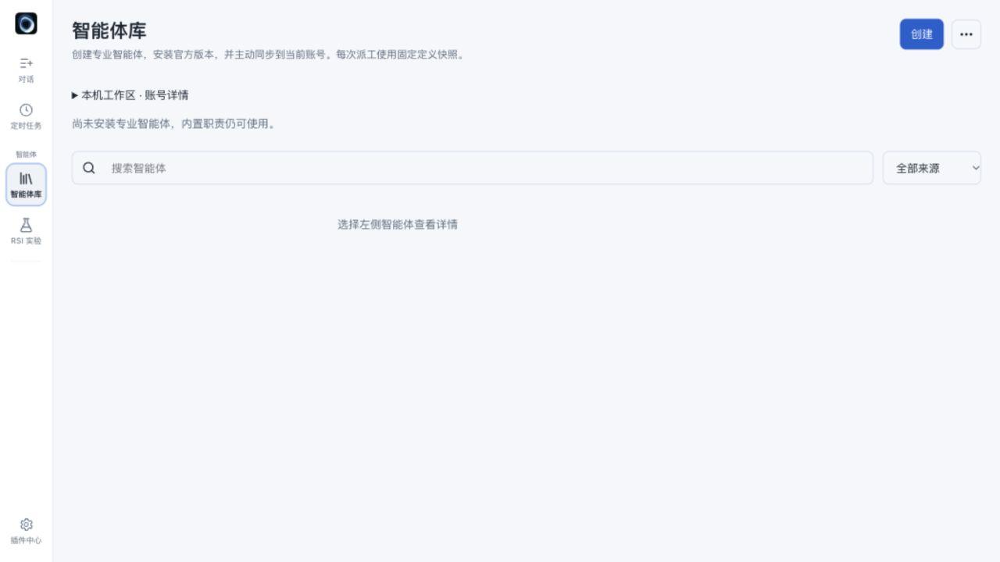
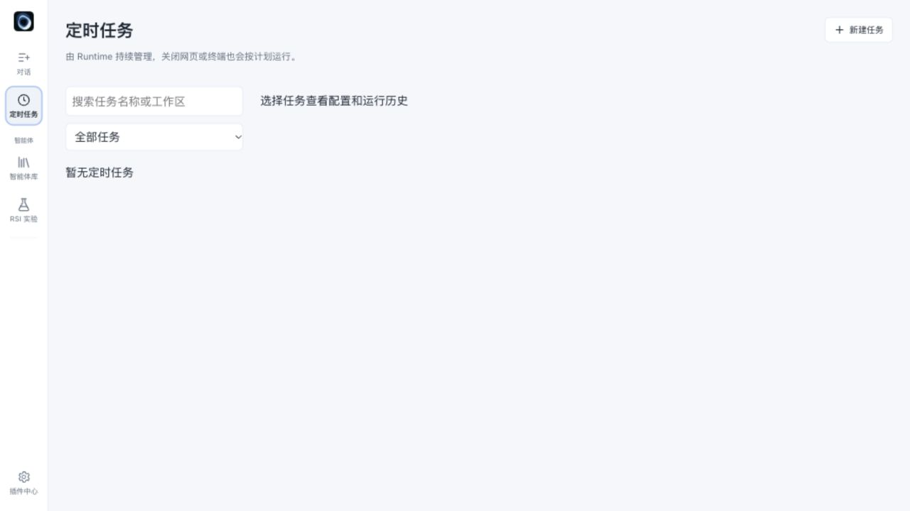
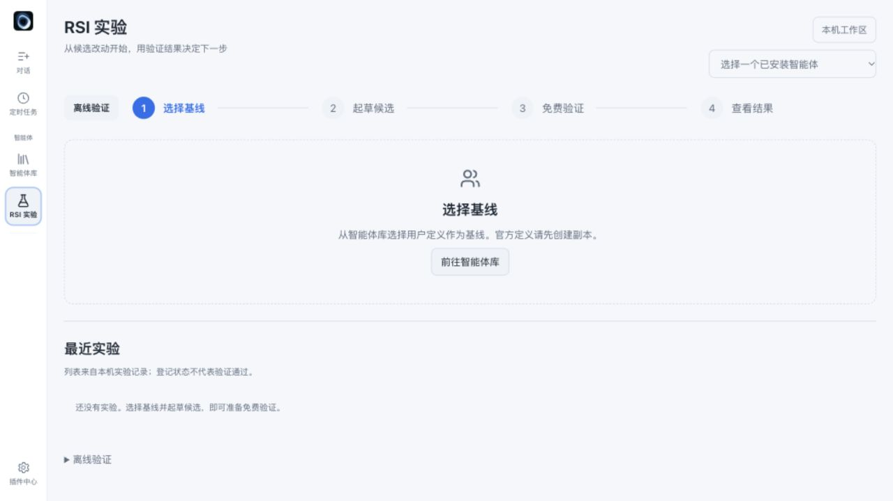
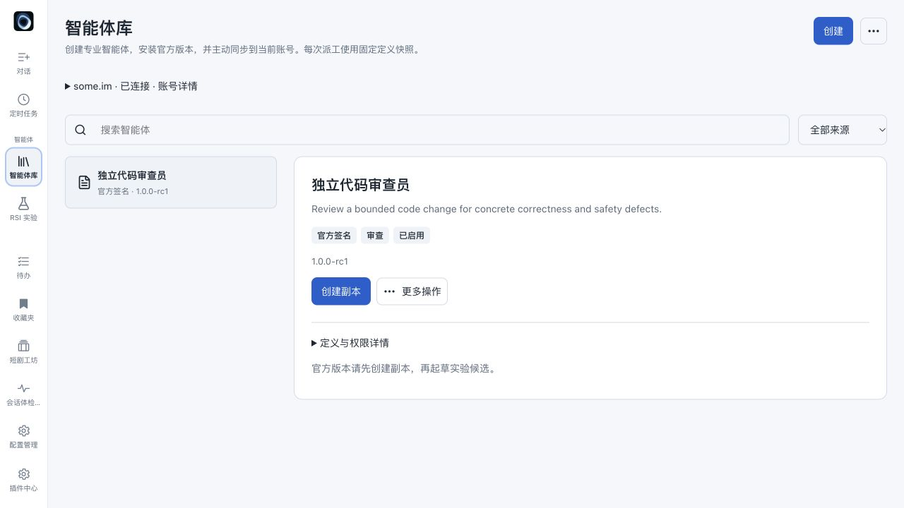

# 0.110.0-rc2 发布验收

基线：`d1ca7fd`（0.109.0-rc2）。本次仅发布 Rust CLI、Runtime、TUI 与内嵌 Web；Mac 和 Android 应用的独立仓库不随本次发布。

## 行为与边界

- 同项目独立会话可发现、发送、回复和跳转；消息持久化，重试复用请求 ID，界面已读与模型消费分别记录。
- 协调消息明确标为外部数据，不构成用户授权。项目范围不扩大 Web 工作区白名单；停止状态、唤醒次数及回复循环保持有界。
- Android 网关提供完整审批正文分页、内容版本校验及只读完整 diff；超限明确拒绝，不把截断预览当作完整审阅。
- Web 使用宽聊天画布、独立协作草稿及按需任务面板。所有页面共用导航，桌面 68px、窄屏 54px，插件菜单不被滚动区裁切。
- 宿主路由信封仅在展示投影隐藏，原始历史及模型上下文保留。

## 验证

最终自动化结果见同目录 `checks.json`。Web 全部 25 个测试文件、160 项测试、ESLint 与生产构建通过。

真实 Runtime 合成模型验收覆盖 A 发送、B 空闲唤醒、模型回复、A 消费与独立已读回执；模型仅运行在本机回环地址，没有调用外部服务。

复跑：先构建 Web 和 CLI，再运行 `ruby scripts/verify_session_collaboration.rb`。可用 `WILLDEEP_BIN` 指定二进制。`scripts/collaboration_surface_fixture.rb` 提供隔离的合成会话视觉验收服务。

待办 `unknown contribution` 的本机根因为已安装 1.4.0 包缺少三个附件命令声明；本机已安装独立仓库现有的 1.5.0 完整包。隔离验收复现旧包错误，验证新包上传、原字节 PNG 预览及删除，未知命令仍被拒绝。该插件修复不是 Rust 宿主放宽命令白名单。复跑需设置 `WILLDEEP_TODO_OLD_PACKAGE`、`WILLDEEP_TODO_FIXED_PACKAGE`。

9847 实际运行服务已验证 0.110.0-rc2，health 与 X-App-Version 一致；原有 40 条待办文件哈希不变、4 个图片预览通过，其他插件注册不变。只读复核脚本需设置 `WILLDEEP_UPDATE_METADATA`（本机备份元数据）、`WILLDEEP_EXPECTED_VERSION`，可选 `WILLDEEP_WEB_URL`。私人元数据与用户附件不随仓库提交。

## 视觉证据

桌面智能体库、定时任务、RSI 在相同视口逐页检查，导航按钮边界一致；390px 窄屏无横向溢出。截图使用合成内容或无私人内容的页面，未经缩放或拼接。

未做完整读屏、真实移动浏览器软键盘或全部第三方插件视觉验收。既有 JavaScript 主包超过 500kB 的构建提示仍存在。
