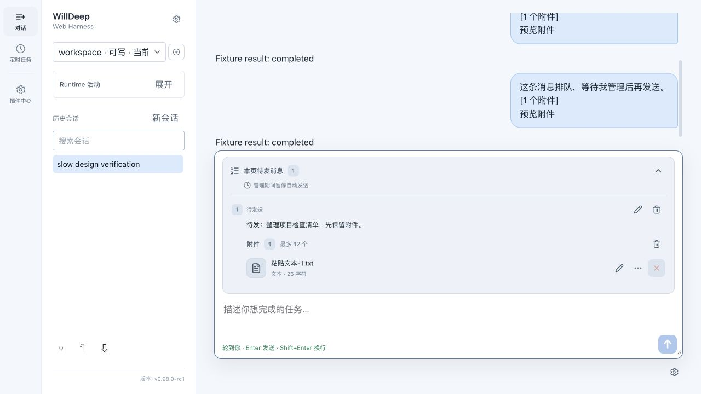
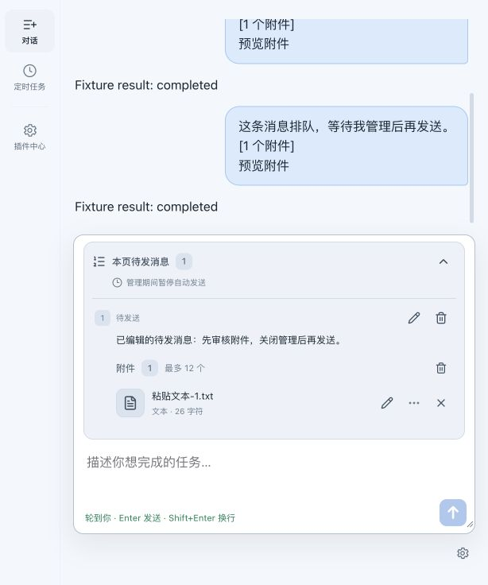
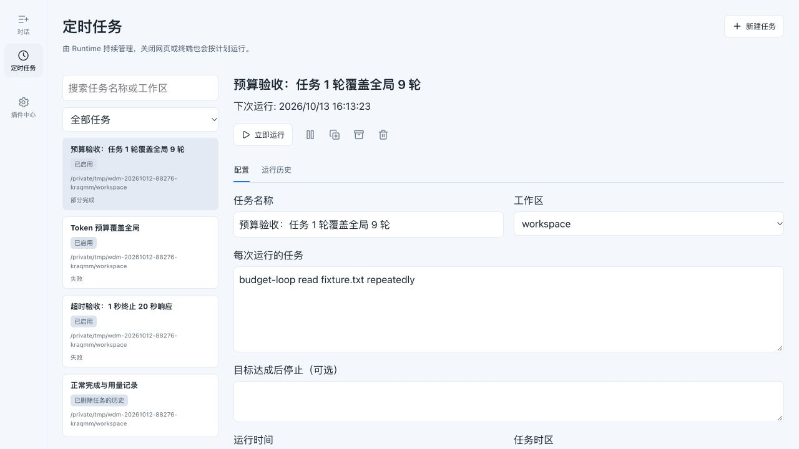
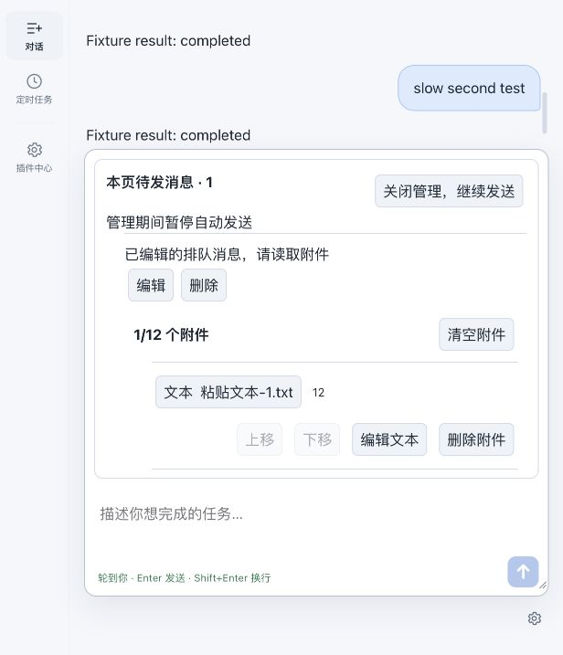
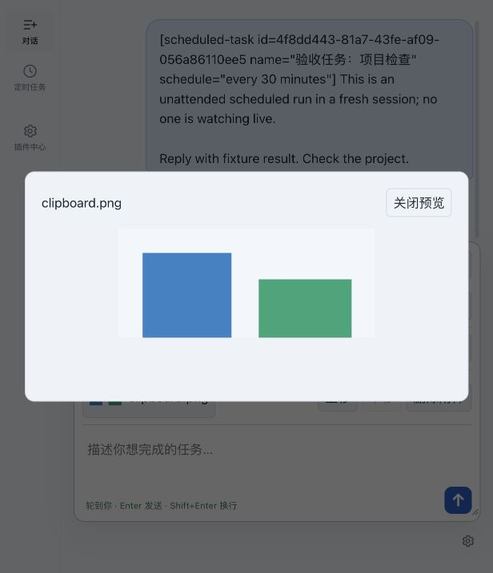

# 附件与 Runtime 定时任务验收

日期：2026-10-12。版本：0.98.0-rc1。

## 实际运行

- [Runtime JSON](runtime-management.json) / [Markdown](runtime-management.md)：全局 9 轮、任务 1 轮，实际只发 1 次模型请求并记录部分完成；Token 预算 1000 覆盖全局 1000000，报告 1103 后阻止下一次请求并按现有 Runtime 语义记录失败；1 秒超时约 1.28 秒终止并记录失败，无自动重放；结果与用量、历史保留、完成消息幂等重试通过。
- [TUI JSON](tui-management.json)：启动真实 CLI，受控 PTY 分别返回终端能力，原生 iTerm2 图片数据与字符半块输出通过。原生图片载荷解码为有效 PNG。未操作物理终端 GUI，不能据此宣称所有终端兼容。
- Web 浏览器：流式期间附带附件入队，管理时暂停自动发送，修改正文后关闭面板才发送；已发送附件只读并可引用到新草稿。图片大图关闭后焦点返回输入区。
- [CLI 完整交互 JSON](tui-queue.json) / [终端最终屏幕](tui-final-screen.txt)：两条消息排队，修改第一条正文与附件后一起送达，第二条删除后未发送；标准终端解析器读取实际增量 ANSI，确认输入区仍保留原草稿。

## 界面检查与调整

1. 草稿与已发送附件：原页面文字按钮挤占内容；改为文件缩略图、名称和类型摘要，编辑、删除、引用用图标，排序展开查看。图标保留可读标签与提示，预览关闭恢复焦点。状态：通过。
2. 待发消息：收起时显示数量、状态和摘要；展开后逐条编辑与删除，编辑时自动聚焦正文，管理期间暂停发送。614 像素窄窗仍保留输入区与操作入口。状态：通过。
3. 定时任务维护：明确「立即运行」，复制、暂停、归档和删除使用图标，配置/历史分栏；375 像素下任务列表限高滚动，详情可访问，新建按钮不再断字。状态：通过。

截图与键盘验证不能证明所有辅助技术兼容；物理终端 GUI 未验证。所有截图来自隔离夹具。

## 复现

使用 `scripts/management_fixture.rb` 启动独立 home、workspace、模拟 Provider 和 Web；输出夹具元数据。随后运行 `scripts/management_verify.rb <fixture.json> <报告目录>`。模拟 Provider 不调用真实付费模型，夹具凭据为占位值。

`scripts/management_tui_verify.rb` 的参数依次为二进制、夹具元数据、隔离会话 JSON、320×180 PNG、输出目录。仅修改指定夹具 home，并记录实际 ANSI 与原生图像数据。

Rust 全量回归、Clippy、格式校验；Web 112 项测试、lint、构建通过。预算与超时测试验证运行机制，不代表真实模型的任务质量或目标达成。

## 管理入口

- TUI：`F3` / `/attachments`、`/attachments sent`，`Ctrl+Q` 打开待发队列并按 `a` 管理选中消息附件。
- 定时任务：Web 左侧「定时任务」；CLI `willdeep schedule --help`；TUI `/schedule list`。
- 暂停计划不会停止正在运行的任务，需在历史中单独停止。归档和删除配置都保留运行历史，历史清理先预览。
- 已提交但回执不确定的消息保留原请求重试；Web 本页待发队列尚不跨刷新持久恢复。
