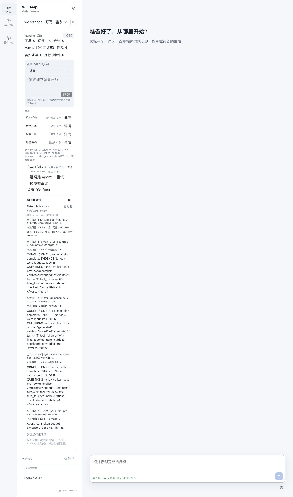

# 一层多 Agent 与 Runtime 托管 Web 验收

日期：2026-10-13。候选版本：0.99.0-rc1。功能验收通过；GitHub 发布、两处 CLI 安装和用户 Runtime 交接作为独立交付状态核验。

| 验收项 | 结果 | 证据 |
| --- | --- | --- |
| 默认并发 8、可配置上限、有界 FIFO | 通过 | Scheduler、12 个后台任务准入与取消测试 |
| 新建、重试、续做共用容量，同 Agent 不能并发执行两个 Run | 通过 | 16 个客户端争抢容量；Registry 重试；预先持久准入的续做测试 |
| 排队不启动模型、工具或创建 worktree，取消释放位置 | 通过 | Background 与 worktree planning 测试 |
| 同 Agent 的 UUID、历史、模型、权限、工作区保持 | 通过 | Catalog continuation、严格工具写集与原权限测试 |
| 重复 request_id 不新增 Run、不重复请求模型 | 通过 | 核心测试、原生 Runtime 请求去重 |
| 父会话空闲也可续做，无额外主模型调用 | 通过 | 原生 Runtime：3 次子调用，主调用 0 |
| 重启保持排队顺序和 Run ID，运行中的不确定执行不盲目重放 | 通过 | Catalog 重建 FIFO；检查点不确定副作用测试 |
| 报告先提交父会话回执，再确认交付 | 通过 | 模拟父会话保存失败时不 ack；Runtime 实际回执持久化 |
| Run 事件携带身份，旧事件不能覆盖新执行 | 通过 | AgentStore 乱序事件与重开存储测试 |
| Run/Agent/团队累计账本、缓存及未知用量分别统计 | 通过 | 用量账本、重复记录去重、辅助/压缩/主/子统计测试 |
| 用量未知、账本不完整及预算用尽时拦截后续请求 | 通过 | 辅助调用专项；原生 Runtime 重启后累计 45 Token，第 4 Run 明确 Blocked 且模型调用 0 |
| 正好耗尽预算的最终答复保持完成状态 | 通过 | 核心边界测试与原生 Runtime 第 3 Run |
| 文件写冲突明确 Blocked，执行超时不计算排队时间 | 通过 | FileClaim、跨进程 FileLease、整体 launcher 超时测试 |
| worktree 合并与新执行互斥；合并后的 Agent 不再续做 | 通过 | 持久 retirement 与准入共用锁、回滚测试；CLI 现有合并回归 |
| CLI/TUI/Web 的状态、续做、历史、累计预算入口 | 通过 | CLI 全套 676 项、前端 117 项；真实 PTY 88 列；实际 Web 操作 |
| `/webapp` 归 Runtime，退出客户端不关服务，重启恢复开关与地址 | 通过 | 独立进程 Web 生命周期 4 项；服务单测；显式关闭持久化 |
| `/mobile` 保持 Runtime 托管路径 | 通过 | 手机中继 22 项回归；发布前用户 Runtime relay connected，未停止用户服务 |

自动化使用假 Provider 与临时 home，没有消耗真实模型额度。手机设备真实连入本次未观察到，不能把 relay connected 称为手机设备在线。

预算是后续请求的准入限制；已经在途的并发调用可能超额，不能承诺严格费用硬上限。缺失用量和不确定执行不冒充零。自动活动统计不包含报告，报告仅在用户显式打开历史时加载并脱敏。

实际进程记录见 [多 Agent Runtime](runtime-team-smoke.md)、[Web 生命周期](runtime-web-smoke.md)；构建与源码哈希见 [最终 JSON](final-verification.json)。早期 core/progress 报告为阶段历史，以本矩阵及最终报告为交付证据。

